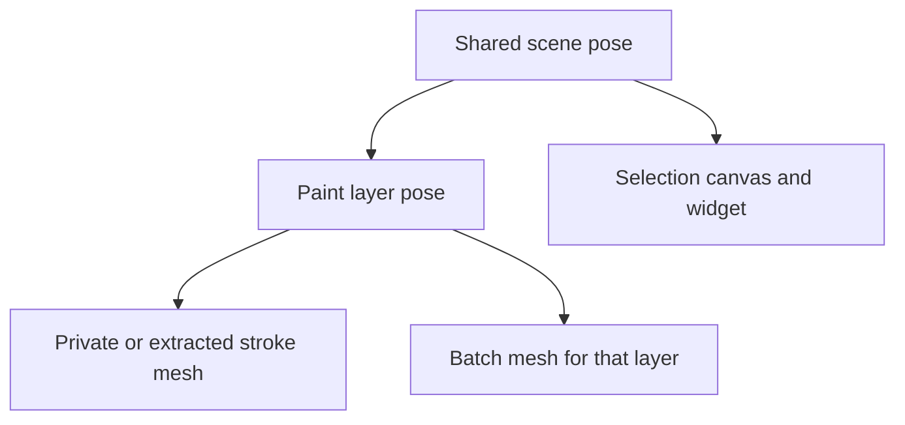

# Native layer transform integration

The file/document contract and layer-parented rendering/tool paths are now
implemented, with [deterministic browser evidence](evidence/brush-fidelity/layer-runtime-2026-10-22/README.md).
[Selection-canvas parenting and visibility](evidence/brush-fidelity/selection-canvas-2026-10-22/README.md)
are implemented with repeated parent-lifecycle acceptance. The application
compatibility adapter preserves packed ECS references; upstream SDK correction
remains separate.
Connected web layer context has separate [two-peer evidence](evidence/brush-fidelity/collab-layers-2026-10-22/README.md).
Native image agreement, real controller gestures and layer-editing UI remain unverified. The full parity goal remains open.

1. **Keep generator inputs layer-local.** `SketchLayer.transform` describes the
   layer-local to scene-local pose in web metres/basis. The file adapter converts
   native `Layers[i].Transform` translation/quaternion conventions separately.
   It retains unchanged native encodings and serializes actual edits. It does
   not multiply control points or brush sizes by layer scale. Such baking could
   change generator thresholds, knot topology and shader attribute semantics.
2. **Parent rendering through the layer: implemented.** `LayerCanvasSystem`
   creates paint-layer entities under the scene pose and applies their local
   TRS. Private, mirrored and preview meshes and batch targets use their layer
   parent. Batches already split by layer. The selection canvas stays under
   the shared scene pose. Preview switching uses the installed SDK's
   `Transform.parent` API and clears/hides the old trail for the reparent frame.

3. **Convert input through the full parent chain: implemented.** Stroke
   start/sampling and preview use the active layer's world position, inverse
   world rotation and uniform world scale. Size and metre-based thresholds
   divide by that combined scale. Synthetic browser input checks local sample
   positions/orientations and brush size, and actual frame updates check a
   preview switch between differently scaled layers. Actual gestures remain open.
4. **Keep tool bounds and edits in a defined space: implemented.** Tool
   broadphase converts world centers/radii through the active layer. Picker
   size uses the stroke parent's world scale. Precise batch hits use actual
   world matrices. Selection bounds are transformed into the widget parent's
   space, and widget displacements into each stroke parent's local basis,
   preserving length. The browser run checks selection movement on two different
   layers, extraction/reinsertion, translated world hits and local saved offsets.
   Full eraser/picker UI and native behavior comparisons remain open.
5. **Other output/transport paths: partial.** GLB layer nodes now carry TRS;
   tests verify that mesh bytes/accessors remain layer-local. Web collaboration protocol v4
   delivers layer IDs/poses before stroke snapshots, gates initial guest input,
   and rejects incompatible retained stroke poses or older peers. Two connected
   desktop browsers verify initial sync, concurrent drawing and offline replay.
   Replacing a shared document ends the session and retains peer work. Native widget
   layer references and room/canvas/media transforms require their own checks;
   retaining opaque fields is not runtime interpretation.
6. **Required acceptance evidence.** Use translated, rotated and scaled layers,
   including composition with a nonidentity scene pose. Check private versus
   batched rendering, preview/authoring input, erase/pick, multi-layer selection
   translation, undo/redo and save/reload. Confirm native layer-local stroke
   values survive export while final world-space geometry agrees with an
   independent reference transform. Verify hidden/locked layer behavior, GLB
   node transforms and connected collaboration. Unit pose/serialization tests
   do not close these interaction or native-rendering gates.

The native source authority is the declared reference's `CanvasScript.LocalPose`,
`SceneScript.LayerCanvasesSerialized()` and `SaveLoadScript` layer load loop.
Native loading changes a legacy zero scale to one, then the canvas takes the
absolute value and clamps local scale to `1e-4..1e4`. The existing 49 bundled
native samples contained no layer metadata during the metadata scan. A suitable
native sketch has been requested; deterministic fixtures cover
the file contract meanwhile. Live Editor verification still awaits recovery of
the native project's detected scene backup.
