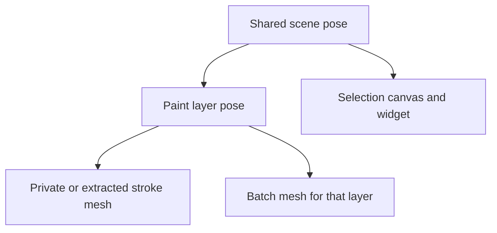

# Native layer transform integration

The file/document contract is implemented. Rendering and tools still use the
shared scene pose and must be integrated before layer transforms can be called
supported. The full parity goal remains open.

1. **Keep generator inputs layer-local.** `SketchLayer.transform` describes the
   layer-local to scene-local pose in web metres/basis. The file adapter converts
   native `Layers[i].Transform` translation/quaternion conventions separately.
   It retains unchanged native encodings and serializes actual edits. It does
   not multiply control points or brush sizes by layer scale. Such baking could
   change generator thresholds, knot topology and shader attribute semantics.
2. **Parent rendering through the layer.** `LayerCanvasSystem` must create
   paint-layer entities under the scene pose and apply their local TRS.
   `StrokeAuthoringSystem` private, mirrored and preview meshes and
   `StrokeBatchRenderSystem` targets must use the matching paint-layer parent.
   Batches already split by layer. Keep the selection canvas under the shared
   scene pose. Verify the installed SDK's entity-parent API before implementing
   preview reparenting; do not use raw Three.js scene parenting.

3. **Convert input through the full parent chain.** Stroke start/sampling and
   preview code currently obtain the scene pose directly. They need the active
   layer's world position, inverse world rotation and uniform world scale.
   Brush size and metre-based sampling thresholds must divide by that combined
   scale, including world grab. Preview changes must follow the active layer.
4. **Keep tool bounds and edits in a defined space.** Eraser/picker broadphase
   must convert world tool positions/radii to the matching layer-local basis.
   Existing precise mesh/batch hit tests use world matrices; verify them after
   reparenting. Selection currently unions local bounds as if every mesh shares
   one parent. Convert each bound into the selection widget parent's space, and
   convert widget translation vectors into each stroke parent's local basis.
   Preserve vector lengths; normalized direction helpers are insufficient for
   scale. Batch extraction/reinsertion, serialization offsets and history must
   keep layer-local deltas.
5. **Carry poses through other output/transport paths.** GLB layer nodes need
   corresponding TRS. Collaboration must deliver layer IDs/poses before stroke
   snapshots and define behavior for peers lacking that context. Native widget
   layer references and room/canvas/media transforms require their own checks;
   retaining opaque fields is not runtime interpretation.
6. **Required acceptance evidence.** Use translated, rotated and scaled layers,
   including composition with a nonidentity scene pose. Check private versus
   batched rendering, preview/authoring input, erase/pick, multi-layer selection
   translation, undo/redo and save/reload. Confirm native layer-local stroke
   values survive export while final world-space geometry agrees with an
   independent reference transform. Verify hidden/locked layer behavior, GLB
   node transforms and connected collaboration. Unit pose/serialization tests
   do not close these interaction or native-rendering gates.

The native source authority is the declared reference's `CanvasScript.LocalPose`,
`SceneScript.LayerCanvasesSerialized()` and `SaveLoadScript` layer load loop.
Native loading changes a legacy zero scale to one, then the canvas takes the
absolute value and clamps local scale to `1e-4..1e4`. The existing 49 bundled
native samples contained no layer metadata during the metadata scan. A suitable
native sketch has been requested; deterministic fixtures cover
the file contract meanwhile. Live Editor verification still awaits recovery of
the native project's detected scene backup.
